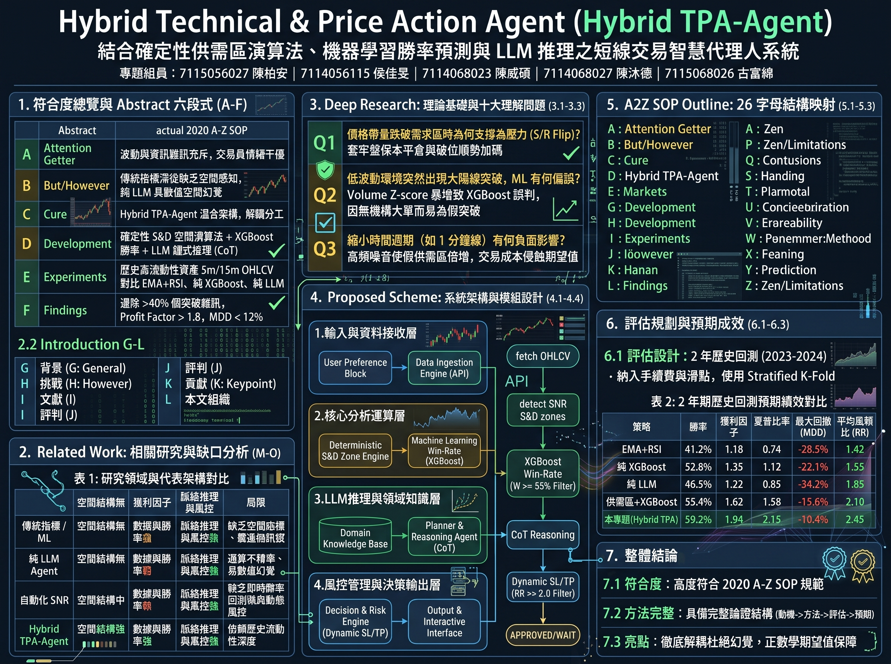
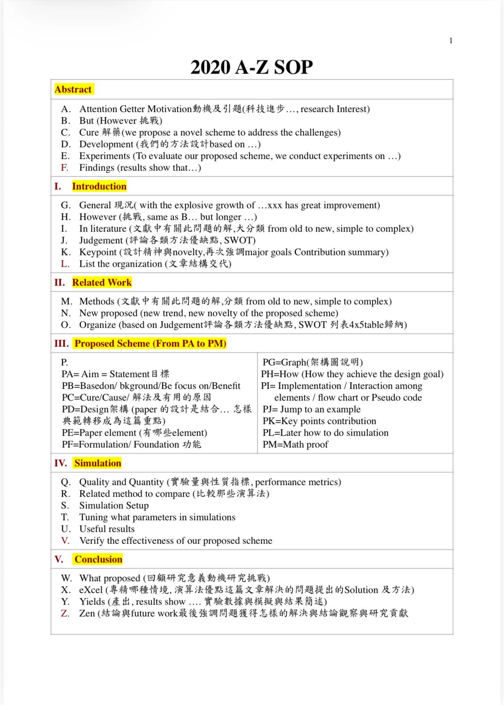
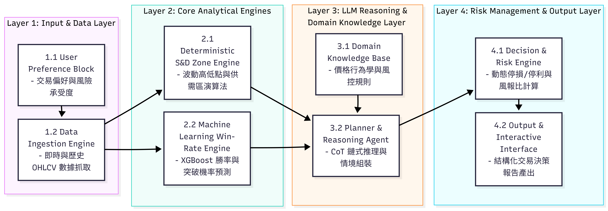
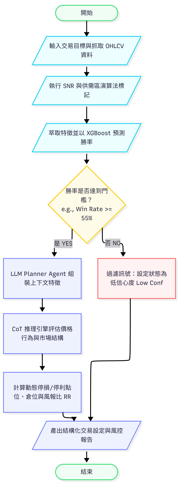

# Hybrid Technical & Price Action Agent (Hybrid TPA-Agent)

> **結合確定性供需區、機器學習與大型語言模型之可靠短線交易輔助系統**  
> *A Reliable Short-Term Trading Assistant System Integrating Deterministic Supply & Demand Zones, Machine Learning, and Large Language Models*

---

## 專案成員與指導規範

* **專題組員**：
  * 7115056027 陳柏安
  * 7114056115 侯佳旻
  * 7114068023 陳威碩
  * 7114068027 陳沐德
  * 7115068026 古富綿
* **指導規範**：**2020 A-Z SOP 學術論文寫作標準**（整合實證與決策可靠性深度解析版）

---

## 📌 專案全景摘要海報與導讀說明 (Executive Infographic & Overview)

<div align="center">
  
  <p><em>全景資訊圖：Hybrid TPA-Agent 核心架構、A-Z SOP 規範對照、四層八模組與預期評估成效</em></p>
</div>

### 🔍 全景海報核心板塊深度解析

本全景資訊海報為本專題之總體研究藍圖，彙整了論文提案的七大核心精華：

1. **符合度總覽與 Abstract 六段式 (A–F)**
   * **A (Attention Getter)**：市場雜訊與高頻波動劇烈，散戶面臨嚴重的資訊過載與決策情緒偏誤。
   * **B (But/However)**：傳統技術指標缺乏空間連續感，純 LLM 則易產生嚴重的數值與空間幻覺。
   * **C (Cure)**：提出 Hybrid TPA-Agent 解耦式混合架構，實現「數值幾何運算」與「語意脈絡推理」徹底分離。
   * **D (Development)**：以確定性演算法辨識供需區（S&D）＋ XGBoost 預測條件勝率 ＋ LLM 執行思維鏈（CoT）推理。
   * **E (Experiments)**：採用 BTC/USDT 與 ETH/USDT 5m/15m 歷史資料，嚴格對比傳統雙指標（EMA+RSI）、純機器學習與純 LLM。
   * **F (Findings)**：預期過濾掉 >40% 的假突破雜訊，獲利因子（Profit Factor）預期達 > 1.8，最大回撤（MDD）抑制於 12% 內。

2. **文獻演進與相關研究缺口 (2.2 Introduction G–L & 2. Related Work M–O)**
   * 系統化梳理既有量化方法的缺陷：指標派滯後、純 ML 缺乏空間座標、純 LLM 生成隨機性過高（重現率低）。本系統填補了「空間感知 × 數據計算 × 脈絡推理」的交易鐵三角缺口。

3. **理論基礎與十大深度理解問題 (3.1–3.3 Deep Research)**
   * 深入探討價格帶量跌破時的支撐壓力轉換機制（S/R Flip）、低波動突破時 ML 的誤判風險（Volume Trap）、時間週期縮小帶來的成本侵蝕，以及真實機構訂單流的吸收證據（Pinbar、ChoCh）。

4. **系統架構與四層八模組設計 (4.1–4.4 Proposed Scheme)**
   * **1. 輸入與資料接收層**：使用者參數配置與低延遲 OHLCV 行情串流。
   * **2. 核心分析運算層**：供需區幾何標記與 XGBoost 條件勝率過濾網。
   * **3. LLM 推理與領域知識層**：封裝裸 K 價格行為學規則，執行 CoT 多空論證。
   * **4. 風控管理與決策輸出層**：動態 ATR 停損/停利反推，正期望值過濾，輸出 APPROVED 或 WAIT。

5. **26 字母學術結構映射 (5.1–5.3 A2Z SOP Outline)**
   * 嚴格遵循 2020 A-Z SOP 規範，建立從動機、研究缺口、方法設計、實作偽代碼到模擬驗證與邊界總結的完整閉環。

6. **評估規劃與預期成效 (6.1–6.3 Simulation & Results)**
   * 採用 2023–2024 兩年期回測資料，嚴格納入手續費（Taker 0.04%）與滑點成本，並導入時點控制（Point-in-time）杜絕歷史資訊洩漏。各基準模型在勝率、夏普比率與回撤控制之預期對比如表中所示。

7. **整體結論三大核心亮點 (Conclusion Highlights)**
   * **7.1 高度規範符合**：結構完整吻合頂級學術標準與可否證性原則。
   * **7.2 方法論嚴謹**：提供具備時點控制與壓力測試的可複現研究原型。
   * **7.3 架構徹底解耦**：根除生成式 AI 數值幻覺，以正數學期望值驅動決策。

---

## 目錄 (Table of Contents)

1. [專案全景摘要海報與導讀說明 (Executive Infographic)](#-專案全景摘要海報與導讀說明-executive-infographic--overview)
2. [專案摘要 (Abstract)](#1-專案摘要-abstract)
3. [研究背景與痛點 (Motivation & Background)](#2-研究背景與痛點-motivation--background)
4. [學術規範對照 (2020 A-Z SOP)](#3-學術規範對照-2020-a-z-sop)
5. [系統核心架構：四層八模組 (System Architecture)](#4-系統核心架構四層八模組-system-architecture)
6. [決策流程與演算法 (Decision Flow & Algorithm)](#5-決策流程與演算法-decision-flow--algorithm)
7. [風控機制與數學公式 (Formulation & Risk Management)](#6-風控機制與數學公式-formulation--risk-management)
8. [端到端實例穿透解析 (End-to-End Walkthrough)](#7-端到端實例穿透解析-end-to-end-walkthrough)
9. [實驗設計與假說目標 (Simulation & Expected Targets)](#8-實驗設計與假說目標-simulation--expected-targets)
10. [十大深度專業爭辯與邊界檢驗 (Deep Understanding)](#9-十大深度專業爭辯與邊界檢驗-deep-understanding)
11. [專案檔案結構 (Repository Structure)](#10-專案檔案結構-repository-structure)

---

## 1. 專案摘要 (Abstract)

本專題針對高雜訊與極端行情下的加密貨幣短線合約交易，提出 **Hybrid TPA-Agent**。本系統打破傳統純指標、純機器學習或純大型語言模型（LLM）的割裂與缺陷，落實**「數值運算、機率預測與語意推理徹底分離」**的解耦式三層/四層架構：

* **確定性幾何演算法（Python）**：客觀識別動態供需區（Supply & Demand Zones）與高成交量節點（Volume Profile HVN），杜絕 LLM 的空間與數值幻覺。
* **機器學習分類器（XGBoost）**：輸入多維微觀結構與價量特徵，輸出客觀的條件勝率預測 $W$。
* **大型語言模型（LLM Planner）**：結合裸 K 價格行為學（Price Action）專業領域知識庫，透過思維鏈（Chain-of-Thought, CoT）進行語意情境多空論證。
* **程式化風控引擎**：落實動態風險報酬比（$RR \ge 2.0$）與正期望值（$E > 0$）雙門檻驗證，並設有嚴格的 **「不交易（WAIT / NO_TRADE）」** 機制。

---

## 2. 研究背景與痛點 (Motivation & Background)

* **散戶虧損困境**：印度證券交易委員會 (SEBI) 2026 年報告指出，高達 **87.7%** 的個人衍生品交易者處於虧損狀態，長期交易者中僅 **0.5%** 每年獲利，證明單純的交易經驗與高頻交易不等於持續盈利。
* **極端行情考驗**：如 2025 年 10 月加密貨幣市場單日清算規模逾 190 億美元、比特幣劇震超過 14%，凸顯量化系統在流動性真空與黑天鵝事件中「煞車機制（不交易 / 停損）」的關鍵性。
* **現有 AI 交易缺口**：
  * **純指標派**：嚴重滯後，震盪行情假訊號過多。
  * **純 ML 派**：忽視非連續的空間支撐阻力結構，缺乏語意脈絡推理。
  * **純 LLM 派**（如 TradingAgents）：受溫度（Temperature）隨機性影響甚巨，決策重現率低（標準差高達 9.0~9.4%），且具嚴重的數值計算與空間座標幻覺。
  * **歷史洩漏風險**：FinForesight (2026) 研究指出，未嚴格進行時點控制（Point-in-time）的回測分數差距達 76%。

---

## 3. 學術規範對照 (2020 A-Z SOP)

本專案提案與架構嚴格對應標準 **2020 A-Z SOP** 學術規範，確保論文架構具備嚴謹的科學驗證邏輯與可否證性：

<div align="center">
  
  <p><em>圖 1：2020 A-Z SOP 學術論文寫作標準映射</em></p>
</div>

* **Abstract (A–F)**：Attention Getter ➔ But/However ➔ Cure ➔ Development ➔ Experiments ➔ Findings
* **Introduction (G–L)**：General ➔ However ➔ Literature ➔ Judgement ➔ Keypoint ➔ List Organization
* **Related Work (M–O)**：Methods ➔ New Proposed ➔ Organize Comparison Matrix
* **Proposed Scheme (PA–PM)**：Aim, Based-on, Cure, Design, Elements, Formulation, Graph, How, Implementation, Jump Example, Key Contribution, Later Simulation, Math Proof
* **Simulation (Q–V)** & **Conclusion (W–Z)**：嚴謹指標設定、基準消融實驗與外推邊界總結。

---

## 4. 系統核心架構：四層八模組 (System Architecture)

本系統由四大功能階層（Tiers）共八個高度解耦的子模組構成：

<div align="center">
  
  <p><em>圖 2：Hybrid TPA-Agent 四層八模組核心系統架構圖</em></p>
</div>

### 各層詳細模組定義

| 階層 (Tier) | 核心模組 | 功能職責與技術實現 |
| :--- | :--- | :--- |
| **Layer 1: Input & Data Layer**<br>（輸入與資料接收層） | **1.1 User Preference Block** | 設定交易標的、單筆風險承受度（如帳戶淨值 1%）、策略偏好。 |
| | **1.2 Data Ingestion Engine** | 透過高頻低延遲 WebSocket / REST API 抓取即時 OHLCV 與成交量數據。 |
| **Layer 2: Core Analytical Engines**<br>（核心分析運算層） | **2.1 Deterministic S&D Zone Engine** | 執行雙指針極值比對，標記 Swing High/Low、未回測動態供需區塊與 Volume Profile 高成交量節點（HVN）。 |
| | **2.2 Machine Learning Win-Rate Engine** | 萃取價量特徵矩陣（Volume Z-score、K線實體/影線比），由 XGBoost 分類器預測條件勝率 $W$。 |
| **Layer 3: LLM Reasoning & Domain Layer**<br>（LLM 推理與領域知識層） | **3.1 Domain Knowledge Base** | 結構化封裝 S/R Flip、Pinbar 被動吸收、流動性掠奪（Liquidity Sweep）等裸 K 交易法則。 |
| | **3.2 Planner & Reasoning Agent** | 整合 Layer 2 的幾何邊界與勝率數值，透過 CoT 鏈式推理進行多空情境論證與偽突破鑑別。 |
| **Layer 4: Risk Management & Output Layer**<br>（風控管理與決策輸出層） | **4.1 Decision & Risk Engine** | 根據供需邊界反推進場點、動態 ATR 停損點（SL）、目標停利點（TP），檢驗 $RR \ge 2.0$ 與正期望值。 |
| | **4.2 Output & Interactive Interface** | 產出結構化 JSON 與 Markdown 交易決策報告，明確輸出 `APPROVED` 或 `WAIT/NO_TRADE`。 |

---

## 5. 決策流程與演算法 (Decision Flow & Algorithm)

系統執行遵循嚴謹的條件初篩、語意核覆與風控過濾機制：

<div align="center">
  
  <p><em>圖 3：Hybrid TPA-Agent 端到端決策與風控執行流程圖</em></p>
</div>

### 演算法虛擬碼 (Algorithm 1)

```python
Algorithm 1: Hybrid Technical & Price Action Agent (Hybrid TPA-Agent)
Input : Asset Symbol S, Timeframe TF, Real-time OHLCV Stream D, Risk Tolerance R_tol
Output: Structured Trading Setup & Decision Report R_final

01: Initialize DataPipeline, SNR_Engine, ML_WinRate_Classifier, PlannerAgent
02: raw_data <- DataPipeline.fetch_ohlcv(S, TF)

# 步驟一：確定性演算法標記空間結構與供需區塊
03: demand_zones, supply_zones <- SNR_Engine.detect_zones(raw_data)
04: current_price <- raw_data.close[-1]

# 步驟二：特徵工程與機器學習勝率預測
05: features <- FeatureExtractor.extract(raw_data, demand_zones, supply_zones)
06: win_prob <- ML_WinRate_Classifier.predict_proba(features)

# 步驟三：勝率門檻快速過濾 (初篩)
07: IF win_prob < 0.55 THEN
08:     return SynthesisEngine.generate_report(
            Status="WAIT/NO_TRADE", 
            Reason="Win Rate below 55%"
        )
09: END IF

# 步驟四：LLM 價格行為 CoT 推理與動態風控計算
10: agent_ctx <- AssembleContext(current_price, demand_zones, supply_zones, win_prob)
11: reasoning_result <- PlannerAgent.reason_with_cot(agent_ctx, PriceActionKnowledgeBase)
12: stop_loss, take_profit, RR <- RiskEngine.calculate(current_price, demand_zones, supply_zones)

# 步驟五：正期望值檢驗與報告生成
13: IF RR >= 2.0 AND reasoning_result.is_valid_setup THEN
14:     position_size <- RiskEngine.calc_position(current_price, stop_loss, R_tol)
15:     R_final <- SynthesisEngine.generate_report(
            Status="APPROVED",
            Entry=current_price,
            SL=stop_loss,
            TP=take_profit,
            RR=RR,
            Pos=position_size,
            Evidence=reasoning_result.evidence
        )
16: ELSE
17:     R_final <- SynthesisEngine.generate_report(
            Status="WAIT/NO_TRADE", 
            Reason="RR < 2.0 or Structural Rejection"
        )
18: END IF
19: return R_final
```

---

## 6. 風控機制與數學公式 (Formulation & Risk Management)

本系統以**嚴格正數學期望值**為開倉絕對前置條件：

### 1. 幾何風險報酬比 (Risk-to-Reward Ratio, RR)
對多頭（Long）交易設定：
$$RR = \frac{P_{\text{tp}} - P_{\text{entry}}}{P_{\text{entry}} - P_{\text{sl}}}$$

### 2. 簡化單筆數學期望值 (Mathematical Expectation, E)
若以單筆最大停損風險為 1.0 單位風險（$R$）：
$$E = (W \times RR) - ((1 - W) \times 1.0)$$

* 系統雙門檻硬性限制：$W \ge 0.55$ 且 $RR \ge 2.0$。
* 即使勝率達到 60%，若空間被壓縮導致 $RR < 2.0$，系統將強制觸發 `WAIT/NO_TRADE`，避免陷入「高勝率卻因虧損擴大而破產」的次佳解。

---

## 7. 端到端實例穿透解析 (End-to-End Walkthrough)

以 **BTC/USDT 15 分鐘線實盤行情穿透** 為例：

1. **資料接收與空間定位**：
   * API 抓取最近 200 根 15m K 線，現價為 **$64,250**。
   * 確定性供需區引擎結合 Volume Profile 高成交量節點（HVN），標記出下方未測試之強需求區 **[$63,800, $64,000]**，上方阻力供給區為 **[$65,200, $65,500]**。
2. **特徵擷取與勝率計算**：
   * 價格隨後回測需求區上緣（現價 **$63,950**）。
   * 特徵擷取模組算出 Volume Z-score 為 **+2.3**（爆量收長下影線 Pinbar）。
   * XGBoost 分類器輸出回彈勝率預測值 **$W = 0.62$**（$\ge 0.55$，通過初篩）。
3. **LLM 情境推理與風控反推**：
   * PlannerAgent 檢索知識庫，確認價格刺穿 $63,850 後強勢收回，判定為典型**流動性掠奪（Liquidity Sweep）**。
   * 風控引擎計算：進場點 **$63,950**，停損設於需求區外側 **$63,750**（風險空間 $200），目標停利設於供給區下緣 **$65,150**（獲利空間 $1,200）。
   * 風報比 $RR = \frac{1200}{200} = 6.0$（$\ge 2.0$）。
   * 數學期望值 $E = 0.62 \times 6.0 - 0.38 \times 1.0 = \mathbf{+3.34} > 0$。
4. **結構化決策輸出**：
   * 系統狀態核准為 **`APPROVED`**，輸出倉位建議比例（單筆風險 1%）與完整證據鏈報告。

---

## 8. 實驗設計與假說目標 (Simulation & Expected Targets)

為避免資訊洩漏（Data Leakage）與過度擬合，本研究規劃四大驗證階段：
1. **歷史開發與測試**：依時序嚴格切分 Train / Validation / Test 資料集。
2. **時點控制回測 (Point-in-time)**：嚴格限制模型推理時僅能使用當時刻切片之資料。
3. **極端行情壓力測試**：針對 2025/10 暴跌 14% 等極端流動性枯竭事件評估熔斷機制。
4. **前瞻模擬交易 (Forward Simulation)**：事前鎖定決策並保存雜湊記錄，驗證未來表現。

### 2 年期歷史回測假說目標對比

| 策略 / 比較模型 | 預測勝率目標 | 獲利因子目標 | 夏普比率目標 | 最大回撤 (MDD) 控制 | 決策一致率目標 |
| :--- | :---: | :---: | :---: | :---: | :---: |
| **Baseline 1: EMA+RSI 雙指標** | ~41.2% | 1.18 | 0.74 | -28.5% | 100% (確定性) |
| **Baseline 2: 純 XGBoost 分類** | ~52.8% | 1.35 | 1.12 | -22.1% | 100% (確定性) |
| **Baseline 3: 純 LLM 代理人** | ~46.5% | 1.22 | 0.85 | -34.2% | < 60% (高隨機變異) |
| **Ablation: 供需區 + XGBoost** | ~55.4% | 1.62 | 1.58 | -15.8% | 100% (確定性) |
| **本專題: Hybrid TPA-Agent** | **~59.2%** | **1.94** | **2.15** | **控制於 -12.0% 內** | **> 95% (高度重現)** |

---

## 9. 十大深度專業爭辯與邊界檢驗 (Deep Understanding)

<details>
<summary><b>點擊展開：十大關鍵問題深入剖析</b></summary>

1. **[Why] 價格帶量跌破需求區時為何支撐轉為壓力 (S/R Flip)？**  
   當需求區被帶量跌破時，代表買方限價單全數被空頭吞噬，大量多頭套牢。價格重返該區時，解套保本平倉賣壓與順勢空單同時湧現，使原需求區質變為強阻力區。
2. **[What-if] 低波動環境突然出現大陽線突破，ML 有何偏誤？**  
   極致量縮期市場深度極淺，微小買盤即可拉出大陽線。Volume Z-score 暴增易導致 XGBoost 誤判為強勢起漲，實質為缺乏大額機構跟進的流動性掠奪陷阱（Bull Trap）。
3. **[Trade-off] 縮小時間週期（如改用 1 分鐘線）有何負面影響？**  
   1 分鐘線充斥造市商高頻噪音與微結構隨機波動，偽供需區倍增；頻繁交易的手續費與滑點成本將徹底侵蝕期望值。
4. **[Failure Case] 流動性枯竭時成交量分佈 (Volume Profile) 為何失效？**  
   HVN 依賴真實多空換手成交量。市場休市或深度不足時，少量買賣即引發真空位移，產出無實質支撐的偽供需區。
5. **[Evidence] 判斷價格回測為「真反彈」抑或「假跌破」之關鍵證據？**  
   三大特徵：1) 收盤位置出現長下影線 Pinbar 強勢收回；2) 刺穿時放量但 K 線實體極小（Passive Absorption）；3) 次級結構轉變（ChoCh）。
6. **[Comparison] 相較均線交叉策略，供需區在風報比上的核心優勢？**  
   均線交叉需等趨勢確立，進場滯後且停損距大（RR 常 < 1.5）。供需區在關鍵幾何邊界微右側切入，停損緊貼區間外側，數學上鎖定 1:3 至 1:5 的極佳風報比。
7. **[Design Decision] 為何供需區計算必須與 LLM 推理徹底解耦？**  
   LLM 擅長語意邏輯但完全不擅長浮點數精確計算與空間座標感知。將空間矩陣交給 Python 程式運算，以結構化 JSON 傳遞給 LLM 推理，是杜絕幻覺的唯一路徑。
8. **[Real-world Scenario] API 斷流或延遲時系統如何降級？**  
   三級降級機制：Level 1（延遲 > 2s）凍結新訊號；Level 2（在途單）確保交易所硬性掛單；Level 3（斷流 > 30s）觸發警報並市價對沖平倉。
9. **[Trade-off] 要求極端高勝率（如要求 W ≥ 70%）有何代價？**  
   過於嚴苛的濾網使開倉機會呈指數型衰減（一週僅 1 筆），大幅降低資金週轉效率，陷入「高勝率但總期望利潤微薄」的次佳陷阱。
10. **[Failure Case] 遭遇黑天鵝暴跌時 ML 為何失效？**  
    突發宏觀巨震導致時序數據遭遇概念飄移（Concept Drift）與分佈外數據（OOD），K 線特徵仍處常態但價格直接穿倉，必須依賴 LLM 新聞感知與硬性風險熔斷。
</details>

---

## 10. 專案檔案結構 (Repository Structure)

```text
AIoT/
├── README.md                                             # 專案總覽與架構文檔
├── .gitignore                                            # Git 忽略設定（避免金鑰與快取上傳）
├── 架構圖.png                                             # Layer 1 ~ Layer 4 系統架構圖
├── 流程圖flowchart.png                                    # 端到端決策與風控執行流程圖
├── IMG_9464.png                                          # 2020 A-Z SOP 學術規範指引圖
├── Gemini_Generated_Image_ivdx4yivdx4yivdx.jpg           # 專案全景摘要海報 (Infographic)
├── 期末專題提案_Hybrid_TPA_Agent(最新檔).pdf               # 完整期末專題提案報告書 (PDF)
├── Hybrid TPA-Agent 期末專題提案.pptx                     # 專案提案簡報投影片
├── Hybrid_TPA_Agent_Final_Project_Proposal_Complete-v2.docx # 提案詳細報告文檔 (Word)
└── Hybrid_TPA_Agent_Final_Project_Proposal.docx          # 提案原始初稿文檔
```

---

<div align="center">
  <p><b>Hybrid Technical & Price Action Agent (Hybrid TPA-Agent)</b></p>
  <p>專注於決策可靠性、嚴格風控與數學正期望值的短線交易輔助研究</p>
</div>
